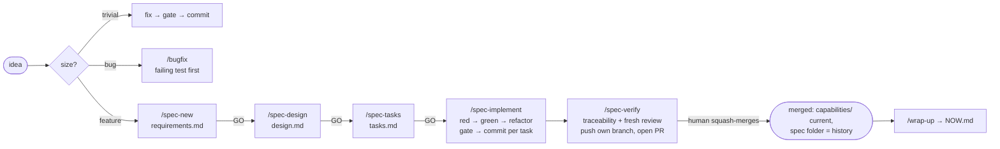

# Workflow and rationale

Why the template is shaped the way it is. Read once; Claude doesn't load this file at startup.

## 1. The flow

| Gate | Question the human answers | Artefact |
|---|---|---|
| Requirements GO | Is this the right problem and behaviour? | `requirements.md`: stories, EARS criteria with IDs, NFRs, non-goals |
| Design GO | Is this the simplest sound way to build it? | `design.md`: contracts, data, errors, test strategy, constitution check |
| Tasks GO | Are the steps small, ordered, and complete? | `tasks.md`: test-first tasks traced to REQ IDs |
| Merge (human only) | Is it proven? The human squash-merges the PR; the agent never merges into `main` | `/spec-verify` report as PR description: gate output, REQ→test table, independent review |

Run each phase in a **fresh session**. The files carry the state, and the context stays small and focused.

## 2. Taken from the PilcrowMD setup

| PilcrowMD practice | Here |
|---|---|
| Human decides, nothing moves without "GO" | GO gates in every spec skill, plus hard rule 9 |
| Main agent plans, decides, merges; heavy work delegated; report ends with "what was delegated to whom" | `CLAUDE.md` *Roles* and `Delegated:` line in every skill. Changed: the agent commits on its own branch, but **only the human merges** into `main` |
| Helper agents in agent files with a fixed model (explorer/test-runner on Haiku, implementer/reviewer on Sonnet, reasoner on Opus) | `.claude/agents/*.md` |
| Independent pre-merge review, ideally another vendor | `reviewer` agent with fresh context + `AGENTS.md` for Codex/Gemini |
| `NOW` file, ≤ 40 lines, 4 sections, rewritten by the agent itself: no handover requests | `docs/state/NOW.md` imported by `CLAUDE.md`, rewritten by `/wrap-up`; the hook warns if it's > 40 lines |
| Finished items go to the archive as one line, which new chats don't read | `docs/state/archive.md` |
| Inbox, one author per file, FYI / REQUEST / NEEDS OWNER, only NEEDS OWNER reaches the human | `docs/state/inbox.md` + SessionStart hook surfacing NEEDS OWNER |
| `facts/`: the only source for public claims | `docs/facts/releases.md` |
| "Verified facts only", MEASURED tags | VERIFIED / ASSUMED tags (hard rule 1) |
| Dashboard numbers only from scripts | Hard rule 10: numbers are copied from tool output; `test-runner` reports "not reported" rather than guessing |
| Slim startup context (−31% tokens) | Lean `CLAUDE.md` + **path-scoped rules** that load only for matching files |
| Don't switch models mid-session (per-model cache); delegate instead | *Context and budget* in `CLAUDE.md` |
| Budget meter: 80% economy, 90% stop | *Context and budget* in `CLAUDE.md` |
| New chat after ~40 exchanges | Same, with `/wrap-up` |

## 3. Added from other practices

| Practice | Source / idea | Where |
|---|---|---|
| **Constitution** checked in every design | GitHub Spec Kit | `docs/constitution.md`, design template |
| **Specify → plan → tasks → implement** as separate artefacts | Spec Kit, Kiro | `/spec-*` skills, `docs/specs/_templates/` |
| **EARS** acceptance criteria with stable IDs | Kiro / requirements engineering (Mavin's EARS) | `requirements.md` template, `specs.md` rule |
| **Traceability** REQ → task → test, checked before merge | Classic V-model, made cheap by agents | `tasks.md` table, `/spec-verify` |
| **Open questions block approval**: ask, don't guess | Spec Kit `[NEEDS CLARIFICATION]` | requirements template |
| **Edge-case checklist** in every spec: each category is a REQ or "N/A: reason"; the human adds cases at the GO; a reviewer who did not write the code hunts for missed cases in the code | Boundary-value analysis / equivalence partitioning; "what did I miss?" review | requirements template, `/edge-cases`, `reviewer` |
| **Invariants enforced in the datastore** (conditional update, constraint, version, lock, idempotency key), each proven by a parallel test on the real DB that fails against the naive version | Constitution article 11; classic lost-update / double-spend bugs | design template *Concurrency and consistency*, `references/concurrency.md` |
| **Property-based tests** for input-shaped logic | QuickCheck family (fast-check, Hypothesis, jqwik) | `testing.md`, stack rules |
| **Current specs vs change records**: `docs/capabilities/` describe behaviour *now* (stable rule IDs); `docs/specs/NNN` folders become history once delivered; `/spec-verify` folds REQs into capabilities before the PR | OpenSpec (capability specs + changes), SDD template guide | `docs/capabilities/`, `/spec-verify` step 4 |
| **Business context** in one file, CONFIRMED vs assumption, single glossary; the agent never invents prices or policies | SDD template guide (BUSINESS.md) | `docs/BUSINESS.md`, hard rule 1, `/spec-new` |
| **Surface conflicts** between code, capability files, and specs; never resolve them silently | SDD template guide | hard rule 7, `reviewer`, `AGENTS.md` |
| **Completion report** with Passed / Failed / **Not run** / Open issues / Documents updated | SDD template guide | *Reporting* in `CLAUDE.md` |
| **MUST / SHOULD / MAY** and optional Given/When/Then **AC scenarios** next to EARS | RFC 2119, BDD | `specs.md`, requirements template |
| **Project README + CONTRIBUTING.md** written at init; leftover `{{placeholders}}` caught | SDD template guide | `/project-init`, session-start hook |
| **Plain, literal responses**: Simplified Technical English, result first, every ID explained in words | ASD-STE100, accessibility practice | `.claude/rules/communication.md` |
| **Test-first** for features, reproduce-first for bugs | TDD | `testing.md`, `implementer`, `/bugfix` |
| **One deterministic gate** (`scripts/check.sh`), same in CI | "Make the right thing the easy thing" | `scripts/check.sh`, `ci.yml` |
| **Hooks enforce; rules advise**: format on edit, block secrets/lockfiles/force-push/`--no-verify` | Claude Code best practice: deterministic over probabilistic | `.claude/hooks/`, `settings.json` |
| **Never weaken checks** to get green | Common LLM failure mode | Hard rule 4, implementer and reviewer prompts |
| **Simplicity and surgical diffs** | Karpathy guidelines | `coding.md`, `karpathy-guidelines` skill |
| **Explore with a cheap read-only agent** before planning | Anthropic "explore → plan → code → commit" | `explorer`, `/spec-design` step 1 |
| **ADRs** for hard-to-reverse decisions | Michael Nygard | `docs/adr/`, `/adr` |
| **Conventional Commits**, one task per commit on the branch, **squash-merge** to `main` (one commit per spec) | conventionalcommits.org, GitHub flow | `git.md` |
| **Branch ownership**: the agent pushes only to branches it created, and never merges PRs | Least privilege for agents | `guard-bash.sh` (registry in `.git/claude-branches`), `settings.json` deny `gh pr merge` |
| **Permissions allow/ask/deny** instead of blanket approval | Claude Code settings | `settings.json` |
| Stack baselines: strict types, lint as errors, coverage floor, wrapper/lockfiles, ProblemDetail, constructor injection, Testcontainers, Flyway | Community best practice per ecosystem | `assets/<stack>/`, `.claude/rules/<stack>.md` |

## 4. Tips

- **Plan mode** (Shift+Tab) is a good fit for `/spec-design`, where Claude reads but doesn't write code.
- **Parallel work:** run tasks marked `[P]` in separate git worktrees (`git worktree add ../app-t3 -b feat/NNN-t3`), one Claude session each. Coordinate through `docs/state/inbox.md`.
- **When Claude keeps making the same mistake**, add one line to the matching `.claude/rules/*.md` file. If the mistake is costly, add a hook or a gate check instead.
- **Keep `CLAUDE.md` under ~120 lines.** Move anything stack- or folder-specific into a path-scoped rule.
- **Review the spec, not just the code.** A wrong requirement implemented perfectly is still wrong. That's what the first GO is for.
