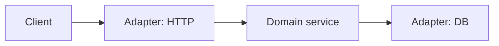

# Spec NNN: {{Feature name}} · Design

- **Status:** draft | approved (GO by {{who}} on {{date}})
- **Requirements:** ./requirements.md

## Summary
The approach in 3 to 5 sentences.

## Constitution check
| Article | Pass? | Note / justified exception |
|---|---|---|
| 1 Spec before code | ✅ | |
| 2 Test-first | ✅ | |
| 3 Simplicity | ✅ | Why this is the simplest design that works |
| 4 Boundaries | ✅ | |
| 5 Contracts | ✅ | |
| 6 Fail loudly at edges | ✅ | |
| 7 Observability | ✅ | |
| 8 Security | ✅ | |
| 11 Invariants in the datastore | ✅ | N/A if no shared mutable state |

## Context (existing code)
Relevant modules and files, found with `explorer`. Paths and line refs. VERIFIED only.

## Architecture
Components and responsibilities. A diagram if it helps (mermaid).

## Contracts
<!-- The public surface. Defined here BEFORE code. -->
- HTTP: method, path, request and response schema, status codes, errors (RFC 9457 problem+json)
- Library/CLI: function signatures and flags
- Events/messages: name, payload, ordering guarantees

## Data model
Entities, fields, types, constraints, indexes, migrations (new migration files only).

## Concurrency and consistency
<!-- One row per invariant from the requirements' "Repeats and concurrency" row, and for any shared
     mutable state the design adds (DB rows, counters, files, caches, external calls with side effects).
     "Check in code, then write" is NOT a mechanism: two requests both pass the check.
     Mechanisms: atomic conditional update (UPDATE ... WHERE qty >= :n, then check rows affected),
     unique constraint, optimistic locking (@Version / version column), SELECT ... FOR UPDATE,
     idempotency key (unique constraint on key + stored response), single-writer queue.
     Write "None: <why>" if the feature has no shared mutable state. -->

| Invariant | Shared state | Mechanism | Loser gets | Covers | Concurrency test |
|---|---|---|---|---|---|
| stock never below 0 | `product.stock` | `UPDATE … SET stock = stock - :n WHERE id = :id AND stock >= :n`, 0 rows → out of stock | 422 problem+json "out of stock" | REQ-… | `*IT`: 10 parallel buyers, stock 1 → exactly 1 success |

## Error handling
| Failure | Detection | Behaviour | Covers |
|---|---|---|---|

## Security and privacy
AuthN/AuthZ, input validation, secrets, PII, threat notes.

## Test strategy
| REQ / NFR | Test level (unit / integration / e2e) | Test name or file |
|---|---|---|
| REQ-1.1 | unit | `should_reject_expired_token` |
| REQ-1.4 (boundaries) | property-based | `amounts_round_trip_for_any_valid_input` |
| REQ-2.1 (last item) | integration, concurrent, real DB | `ParallelPurchaseIT.only_one_buyer_gets_last_item` |

## Alternatives considered
| Option | Why not |
|---|---|

## Risks and rollout
Migration plan, feature flag, backwards compatibility, rollback.
