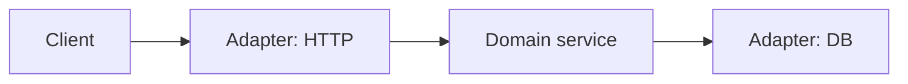

# Spec NNN: {{Feature name}} · Design

- **Status:** draft | approved (GO by {{who}} on {{date}})
- **Requirements:** ./requirements.md

## Summary
The approach in 3 to 5 sentences.

## Constitution check
| Article | Pass? | Note / justified exception |
|---|---|---|
| 1 Spec before code | ✅ | |
| 2 Test-first | ✅ | |
| 3 Simplicity | ✅ | Why this is the simplest design that works |
| 4 Boundaries | ✅ | |
| 5 Contracts | ✅ | |
| 6 Fail loudly at edges | ✅ | |
| 7 Observability | ✅ | |
| 8 Security | ✅ | |

## Context (existing code)
Relevant modules and files, found with `explorer`. Paths and line refs. VERIFIED only.

## Architecture
Components and responsibilities. A diagram if it helps (mermaid).

## Contracts
<!-- The public surface. Defined here BEFORE code. -->
- HTTP: method, path, request and response schema, status codes, errors (RFC 9457 problem+json)
- Library/CLI: function signatures and flags
- Events/messages: name, payload, ordering guarantees

## Data model
Entities, fields, types, constraints, indexes, migrations (new migration files only).

## Error handling
| Failure | Detection | Behaviour | Covers |
|---|---|---|---|

## Security and privacy
AuthN/AuthZ, input validation, secrets, PII, threat notes.

## Test strategy
| REQ / NFR | Test level (unit / integration / e2e) | Test name or file |
|---|---|---|
| REQ-1.1 | unit | `should_reject_expired_token` |

## Alternatives considered
| Option | Why not |
|---|---|

## Risks and rollout
Migration plan, feature flag, backwards compatibility, rollback.
